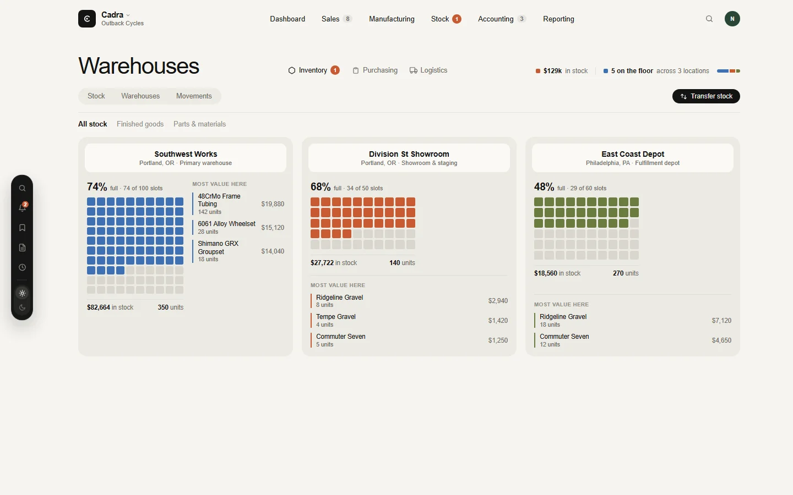

# UI/UX Craft Pro (`ui-ux-pro-max`)

A lean, single-source design engineering skill for AI coding agents — upgrading standard web, SaaS, dashboard, e-commerce, and app interfaces with mathematical optical rules, interactive stage archetypes, asymmetric spring physics, and a deterministic `--strict` anti-slop audit gate.

Built upon [nextlevelbuilder/ui-ux-pro-max-skill](https://github.com/nextlevelbuilder/ui-ux-pro-max-skill), stripped of multi-platform mirror bloat and hardened with strict optical, motion, cutout, and browser-verification gates.


*Rendered directly from `projects/cadra-dashboard/index.html` (0 violations, 0 warnings under `audit_anti_slop.py --strict`).*

---

## Why `ui-ux-craft-pro` vs Upstream `ui-ux-pro-max-skill`

| Capability | Upstream `ui-ux-pro-max-skill` | `ui-ux-craft-pro` |
|---|---|---|
| **Packaging & Maintenance** | Duplicated mirrors (`.claude/`, `skills/`, `cli/`, `src/`, `stack/`) | **Single-source core (~2.2 MB total)** — zero drift, copy once into any agent's `skills/` directory |
| **Layout Direction** | Generic static style/color tokens | **12 Spatial Stage Archetypes (`data/stage-archetypes.csv`)** rejecting flat `Hero + 3 boxes` clichés |
| **Optical Geometry & Surfaces** | General prose guidelines | **Mathematical Optics (`references/craft-physics-and-optics.md`)**: $R_{\text{outer}} = R_{\text{inner}} + \text{Padding}$, `Surface 0 → 1 → 2` luminance ladder, `1px` specular bevels, `tabular-nums` |
| **Motion Engineering** | Generic timing advice | **28 Living UI / GSAP Choreography Presets** + asymmetric deceleration curves (`cubic-bezier(0.16, 1, 0.3, 1)`) + zero `transition: all` |
| **Pre-Delivery Quality Gate** | Prompt-based LLM `/design-review` | **Deterministic CLI Gate (`scripts/audit_anti_slop.py --strict`)**: fails on AI purple/indigo gradients, cliché copy/personas (`10x faster`, `SaaSify`, `Alex Chen`), robotic transitions, missing `tabular-nums`, dead static pages, cartoon SVG stages & WCAG regressions |
| **Photorealistic Stages** | No cutout/QA pipeline | **4-Phase Pipeline + `scripts/extract_studio_cutout.py`**: `rembg` neural segmentation + `distance_transform_edt` de-haloing + dual-tone `--contact-sheet` + mandatory headless Chrome screenshot check |

---

## Searchable Local Catalog (`data/`)

- **12** interactive stage archetypes (`stage-archetypes.csv`)
- **79** searchable visual styles (**50** active)
- **192** product palettes & UI reasoning profiles
- **74** curated font pairings & Google Font entries
- **119** UX & accessibility guidelines
- **105** icon rules & vector conventions
- **28** GSAP & Living UI choreography presets
- **25** chart types across **22** frontend/mobile/desktop stacks

---

## Quick Install (Works Across Modern AI Coding Tools)

Clone this repo and copy only the runtime skill (`SKILL.md`, `data/`, `references/`, `scripts/`) into your tool's skills folder:

| Agent / Tool | Target Directory |
|---|---|
| **Antigravity** | `~/.gemini/config/skills/ui-ux-pro-max/` |
| **Claude Code** | `~/.claude/skills/ui-ux-pro-max/` |
| **Cursor** | `.cursor/skills/ui-ux-pro-max/` or `~/.cursor/skills/ui-ux-pro-max/` |
| **Codex / Universal** | `~/.codex/skills/ui-ux-pro-max/` |

```powershell
git clone https://github.com/CaptainFatih61/ui-ux-craft-pro.git
$dst = "$env:USERPROFILE\.gemini\config\skills\ui-ux-pro-max"
New-Item -ItemType Directory -Force -Path $dst | Out-Null
Copy-Item SKILL.md, data, references, scripts -Destination $dst -Recurse -Force
```

---

## CLI Toolkit (`scripts/`)

1. **Generate a complete design system (with `--variance`, `--motion`, `--density` dials):**
   ```bash
   python scripts/search.py "fintech analytics dashboard" --design-system --variance 7 --motion 6 --density 8 -p "App"
   ```
2. **Search specific domains or stacks:**
   ```bash
   python scripts/search.py "fashion lookbook runway" --domain stage
   python scripts/search.py "keyboard focus modal" --domain ux
   python scripts/search.py "re-render list optimization" --stack nextjs
   ```
3. **Run the Strict Anti-Slop & Accessibility Audit:**
   ```bash
   python scripts/audit_anti_slop.py . --strict
   ```
4. **Extract clean neural studio cutouts (`rembg` + de-haloing + dual-tone contact sheet):**
   ```bash
   uv run --with pillow --with numpy --with opencv-python-headless --with rembg \
     --with onnxruntime --with scipy python scripts/extract_studio_cutout.py \
     input.png output.png --mode model --clean-leg-floor --contact-sheet check.png
   ```
5. **Validate all 36 runtime CSV tables:**
   ```bash
   python scripts/validate-csv.py
   ```

---

## Flagship Pure-Code Showcases (`projects/`)

- [`projects/cadra-dashboard/`](projects/cadra-dashboard/index.html) — Living telemetry workspace, 10×10 dot-matrix capacity grids & diagonal staggered KPI architecture
- [`projects/vertix-dashboard/`](projects/vertix-dashboard/index.html) — High-craft financial cockpit with clip-path pill navigation & frosted card controls

---

## Repository Structure

```text
├── SKILL.md         # Core skill prompt & 4-Pillar / 4-Phase engineering workflow
├── data/            # 36 zero-network BM25 CSV tables (incl. stage-archetypes & motion)
├── references/      # Craft physics/optics math, Living UI blueprints & UX checklists
├── scripts/         # search.py, audit_anti_slop.py, extract_studio_cutout.py, validate-csv.py
├── assets/          # Verified rendered preview WebP for documentation
└── projects/        # Flagship zero-dependency HTML showcases passing --strict audit
```

## License

MIT — see [LICENSE](LICENSE). Built upon [nextlevelbuilder/ui-ux-pro-max-skill](https://github.com/nextlevelbuilder/ui-ux-pro-max-skill).
